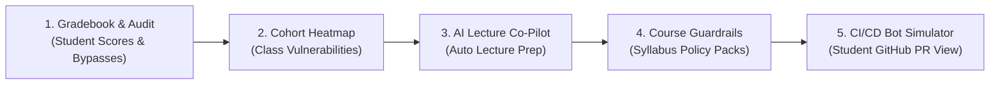

# 🛡️ Ariadne Instructor Security Portal — Quick Walkthrough Guide

**Live Prototype URL:** [https://zydric.github.io/ariadne-instructor-portal/](https://zydric.github.io/ariadne-instructor-portal/)  
**Course Pilot Context:** *CSIT 321 — Enterprise Web Systems & Security* (CIT-U)  
**Target Audience:** Instructors, Department Chairs, & Capstone Advisers

---

## 📌 Executive Summary (The Problem We Solve)

In programming and enterprise web courses, instructors face three recurring pain points:
1. **Grading Blind Spots:** Traditional unit-test autograders only check if code *works*, not if it is *secure*. Students pass functional tests while leaving critical vulnerabilities (SQL Injection, hardcoded API keys) in their submissions.
2. **Academic Integrity Bypasses:** When security tools are introduced, students frequently attempt to "game" the grader by commenting out vulnerable methods, suppressing warnings (`@SuppressWarnings`), or deleting test assertions.
3. **Curriculum Disconnect:** Instructors lack visibility into cohort-wide conceptual weaknesses, making it difficult to tailor weekly lectures to what students are actually struggling with.

**Ariadne solves this by functioning as an automated security co-pilot for faculty and an automated gatekeeper for student code.**

---

## 🗺️ Recommended 3-Minute Review Flow

If you are exploring the portal for the first time, follow this sequence:

---

## 📑 Tab-by-Tab Breakdown

### 1. 📊 Gradebook & Audit (Default Tab)
> **Goal:** Give instructors a real-time, automated security gradebook with forensic audit capabilities.

* **Top KPI Cards:**
  * **Cohort Average (76/100):** Real-time weighted score across all student repositories.
  * **Pass Rate (45%):** Percentage of the cohort passing current course security policies.
  * **Critical Findings (11):** Unmitigated high-risk vulnerabilities across the section.
  * **Academic Integrity Flags (0):** Active bypass markers detected.
* **Student Roster:**
  * Lists student submissions with section tags (`BSIT 3A`, `BSIT 3B`, `BSCS 3A`), commit hashes, live calculated scores (0–100), and policy status badges (`Passed`, `Blocked`, `Pending`).
* **Try this interaction:**
  1. Click **"Inspect Audit 🔍"** on student **Juan Carlos Dela Cruz**.
  2. Notice the breakdown of security findings.
  3. Look at the **Academic Integrity Audit** section: Ariadne flags whether a student attempted to bypass grading by commenting out code rather than fixing it.
  4. Click **"Export CSV"** in the top right to see LMS export options (Canvas, Moodle, Standard CSV).

---

### 2. 🔥 Cohort Heatmap & AI Lecture Co-Pilot
> **Goal:** Transform raw vulnerability scans into pedagogical insights and zero-prep lecture material.

* **Cohort Heatmap Matrix:**
  * Shows sections on the vertical axis and vulnerability categories on the horizontal axis (SQL Injection, Hardcoded Secrets, Path Traversal, Null Pointers, Broken Access Control).
  * Color-coded density percentages highlight where common errors cluster (e.g., *57% of BSIT 3A struggling with SQL Injection*).
* **AI Lecture Co-Pilot:**
  * Below the heatmap, click **"✨ Co-Pilot: SQLi Lecture Notes"**.
  * **What it generates automatically:**
    1. **Cohort Summary:** Explains in plain English what students did wrong across their commits.
    2. **3 Talking Points:** Ready-to-use bullet points for tomorrow's slide deck or whiteboard discussion.
    3. **Before & After Pattern Comparison:** Side-by-side insecure snippet vs. secure `PreparedStatement` remediation.
    4. **Formative Assessment Quiz:** A 2-question quiz for in-class recitation, complete with clickable answer options and an instructor explanation key.
    5. **"📋 Copy Notes for Slides / LMS":** One-click button to export notes directly into Canvas/Moodle announcements.

---

### 3. 🛡️ Course Guardrails
> **Goal:** Allow instructors to enforce syllabus-aligned security baselines without writing scripts.

* **Year-Level Syllabus Packs:**
  * **2nd Year (OOP):** Focuses on basic hygiene, null checks, and hardcoded credentials.
  * **3rd Year (Web Systems):** Enforces OWASP Top 10 (SQLi, XSS, CSRF, Path Traversal).
  * **4th Year (Capstone):** Hardened enterprise baseline with zero-tolerance policies.
* **Interactive Policy Controls:**
  * **Zero Critical Policy Toggle:** Automatically fails any submission that contains even one Critical severity vulnerability.
  * **Granular Rule Penalty Sliders:** Adjust point deductions for specific vulnerability types (e.g., -25 pts for SQLi).
* **Try this interaction:**
  1. Switch to **Course Guardrails**.
  2. Toggle the **"Zero Critical Policy"** switch or change a penalty slider.
  3. Switch back to the **Gradebook** — notice that all student scores and pass/fail statuses recalculate instantly!

---

### 4. 🤖 CI/CD Bot Simulator (Student PR Experience)
> **Goal:** Show what the student experiences inside GitHub when submitting their lab assignments.

* **Simulated Repository Gatekeeper:**
  * Demonstrates the 3-step student remediation journey:
    * **Step 1 (`v1-initial`):** Student pushes code with a raw SQL query. The Ariadne bot fails the GitHub Check Run and leaves an explanatory, pedagogical review comment on the Pull Request.
    * **Step 2 (`v2-bypassed`):** Student tries to cheat the grader by commenting out `Statement.executeQuery()`. Ariadne detects the bypass, flags an **Academic Integrity Violation**, and blocks the merge.
    * **Step 3 (`v3-fixed`):** Student refactors using parameterized queries. The bot turns green (`✅ 100/100`), approves the Pull Request, and marks the lab assignment as passed in the instructor's gradebook.
* **Try this interaction:**
  1. Select student **Juan Carlos Dela Cruz**.
  2. Select sample version **`v1-initial`** and click **"🚀 Run Push & Ariadne Gatekeeper"**.
  3. Watch the check run fail and inspect the simulated GitHub Bot PR comment.
  4. Select **`v2-bypassed`** and run again to observe the integrity flag.
  5. Select **`v3-fixed`** to see the 100% pass state.

---

### 5. 👥 Student Join & Quick Onboarding
> **Goal:** Frictionless setup for students to connect their IDE or GitHub repo to the section.

* Displays the active **Section Join Code** (e.g., `CIT-CSIT321-3A`).
* Outlines the 3-step student instructions: install the Ariadne VS Code extension, enter the code, and link their GitHub repository for automated assignment tracking.

---

## 🎨 UI Controls (Top Navigation Bar)

* **Palette Toggle (`Palette: Semantic` / `Palette: Strict`):**
  * *Semantic:* Uses intuitive status colors (green for passed, amber for warnings, red for critical blocks/integrity violations) for quick scanning.
  * *Strict:* Uses the unified institutional corporate palette for formal reporting.
* **Dark / Light Mode Toggle (Moon / Sun):**
  * Seamlessly toggles between a balanced charcoal dark theme and a clean high-contrast light theme.
* **Reset Demo Button:**
  * Restores all data back to the clean CIT-U pilot starting state at any time.

---

## 💡 Summary for Discussion

| Question | Ariadne's Answer |
| :--- | :--- |
| *Does this replace our existing LMS?* | No. It augments Canvas/Moodle with automated security grading and one-click gradebook CSV exports. |
| *Does the instructor need to configure complex YAML files?* | No. Instructors pick ready-made syllabus packs from the **Course Guardrails** tab. |
| *How does it prevent AI or shortcut cheating?* | The **Academic Integrity Audit** inspects AST diffs for comment-out evasions and suppression tags. |
